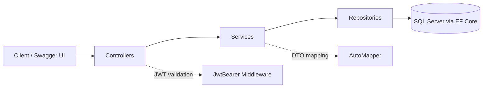

# SchoolManagement API

A RESTful backend for managing the core operations of a school: students, teachers, classes, subjects, enrollments, attendance, grades, and school events. Built with **ASP.NET Core 8 Web API**, **Entity Framework Core**, and **SQL Server**, and secured with **JWT bearer authentication**.

---

## 1. Overview

SchoolManagement gives schools a single API to digitize day-to-day administration. It follows a layered design (Controller → Service → Repository → Database) so each concern stays isolated, testable, and easy to extend.

---

## 2. Features

- **Authentication and authorization** using JWT bearer tokens
- **User management** with token issuing through a dedicated `JwtService`
- **Student management** (create, read, update, delete)
- **Teacher management** and **teacher-to-class/subject assignments**
- **Class and subject management**
- **Enrollment management** linking students to classes
- **Attendance tracking**
- **Grade management**
- **School events** (calendar of school activities)
- **Interactive API documentation** through Swagger UI with JWT support
- **Object mapping** between entities and DTOs using AutoMapper

---

## 3. Tech Stack

| Layer | Technology |
|-------|------------|
| Framework | ASP.NET Core Web API (.NET 8) |
| Language | C# (nullable reference types enabled) |
| ORM | Entity Framework Core 9 (SQL Server provider) |
| Database | Microsoft SQL Server |
| Authentication | JWT Bearer (`Microsoft.AspNetCore.Authentication.JwtBearer`) |
| Mapping | AutoMapper 12 |
| API Docs | Swashbuckle (Swagger / OpenAPI) |

---

## 4. Architecture

The project separates responsibilities into clear layers. Controllers handle HTTP, services hold business logic, repositories handle data access, and `SchoolDbContext` talks to SQL Server.



*Figure 1: Request flow through the application layers.*

---

## 5. Project Structure

```
SchoolManagement/
├── Controllers/        # API endpoints
├── Service/            # Business logic (Student, Teacher, Class, Subject,
│                       #   User, Jwt, Attendance, Enrollment, Grade,
│                       #   SchoolEvent, TeacherAssignment)
├── Repository/         # Data-access layer, one repository per entity
├── Data/               # SchoolDbContext and entity models
├── Mappings/           # AutoMapper profiles
├── Migrations/         # EF Core migrations
├── Properties/         # Launch settings
├── Program.cs          # Application startup and dependency injection
├── appsettings.json    # Configuration
└── SchoolManagement.http  # Sample HTTP requests
```

---

## 6. Getting Started

### 6.1 Prerequisites

- [.NET 8 SDK](https://dotnet.microsoft.com/download/dotnet/8.0)
- SQL Server (LocalDB, Express, or full edition)
- EF Core CLI tools: `dotnet tool install --global dotnet-ef`

### 6.2 Clone the Repository

```bash
git clone https://github.com/marslanakram/SchoolManagement.git
cd SchoolManagement
```

### 6.3 Configure the Application

Open `appsettings.json` (or `appsettings.Development.json`) and set your connection string and JWT settings:

```json
{
  "ConnectionStrings": {
    "DefaultConnection": "Server=YOUR_SERVER;Database=SchoolManagementDb;Trusted_Connection=True;TrustServerCertificate=True;"
  },
  "JwtSettings": {
    "Issuer": "SchoolManagement",
    "Audience": "SchoolManagementUsers",
    "Key": "REPLACE_WITH_A_LONG_RANDOM_SECRET_AT_LEAST_32_CHARACTERS"
  }
}
```

> **Important:** never commit real secrets. Use [User Secrets](https://learn.microsoft.com/aspnet/core/security/app-secrets) or environment variables for the JWT key and production connection strings.

### 6.4 Create the Database

```bash
dotnet ef database update
```

### 6.5 Run the API

```bash
dotnet run
```

Then open Swagger UI in your browser at `https://localhost:<port>/swagger` (the port is shown in the console output).

---

## 7. Authentication

The API uses JWT bearer tokens.

1. Register or log in through the user endpoints to receive a token.
2. In Swagger UI, click **Authorize** and paste **only the token** (the `Bearer` prefix is added automatically).
3. Protected endpoints will now accept your requests.

Tokens are validated for issuer, audience, lifetime, and signing key, with zero clock skew.

---

## 8. API Modules

| Module | Responsibility |
|--------|----------------|
| Users | Account management and token generation |
| Students | Student records |
| Teachers | Teacher records |
| Classes | Class definitions |
| Subjects | Subject catalogue |
| Enrollments | Student-to-class enrollment |
| Teacher Assignments | Linking teachers to classes and subjects |
| Attendance | Daily attendance records |
| Grades | Student grades and results |
| School Events | School calendar and announcements |

Use Swagger UI for the complete, always up-to-date list of routes and request/response models. Sample requests are also available in `SchoolManagement.http`.

---

## 9. Production Notes

Before deploying, consider tightening these development-friendly defaults:

- **CORS:** the `AllowAll` policy permits any origin, method, and header. Restrict it to your frontend's origin(s).
- **Swagger:** it is currently enabled in all environments. Limit it to Development if the docs should not be public.
- **Secrets:** move the JWT key and connection string out of source control.

---

## 10. Roadmap

- Role-based authorization (Admin, Teacher, Student, Parent)
- Unit and integration tests
- Pagination, filtering, and search on list endpoints
- Fee and billing module
- Parent portal and notifications
- Docker support and CI/CD pipeline

---

## 11. Contributing

Contributions are welcome. Fork the repository, create a feature branch, commit your changes, and open a pull request.

---

## 12. Author

**Muhammad Arslan Akram** — [@marslanakram](https://github.com/marslanakram)
